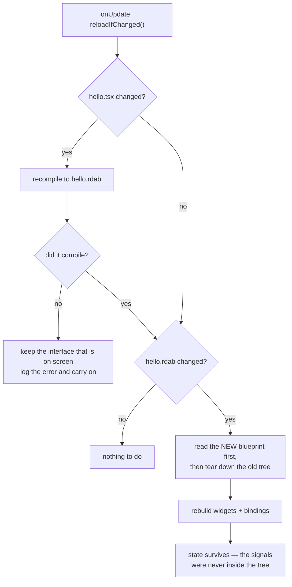

# Hot reload

Debug builds only. `RDA_ENABLE_HOT_RELOAD` is what pulls the layout compiler into the
binary at all — a Release build does not contain it. It does contain QuickJS, as the runtime
a layout's functions run on, started only when a layout has some.

A layout's functions reload with it. They hold no state of their own -- what they read and
write is signals and tables -- so a reload swaps the code and keeps everything the reader
did.



Two properties fall out of the design rather than being engineered:

- **A syntax error costs you a message, not your window.** The interface on screen is the
  last one that compiled.
- **State survives a reload.** Signals live in the application, outside the artifact being
  replaced, so the rebuild is total and still correct. Click a button, edit a label, save
  — the label changes and the count does not.

A development build is told where the *source* lives (`MYAPP_SOURCE_DIR`), because
assets are copied beside the executable and editing the copy would change nothing anyone
can see.

## The look reloads too

A layout is half of what somebody edits in a loop. The other half is what it looks like --
`res/themes/*.ts` and `res/mesh/*.ts` -- and that half used to need the application
restarted, which is worst exactly where it matters most: authoring a shape means moving a
corner two units and looking at it, twenty times.

`Layout/StyleWatch.h` watches both. No application asks for it: a layout is something the
application names and polls, but a theme and its meshes are the engine's own assets and it
already knows where they are, so the poll is in the frame.

```
res/mesh/tab.ts    -> tab.rdam    recompiled; the mesh library is cleared
res/themes/app.ts  -> app.rdth    recompiled; the theme is replaced
either artifact, written by something else   reloaded, with no compiler in this build
```

**Meshes go first**, in the build's own order: what a mesh declares is part of what a theme
may carry, so a theme cannot be checked until every mesh has spoken. The declarations are
read back out of the compiled `.rdam` rather than by evaluating the sources again -- the
engine has them parsed already, and it means a mesh shipped without its source still
contributes its parameters. That ordering is what lets somebody add a mesh parameter and set
it in the theme in the same minute.

Three things fall out, each of which is a decision rather than an accident:

- **A theme reload replaces rather than merges.** Deleting a line from a theme should put
  that colour back to the default, and this loop is mostly deleting a line and looking
  again. The cost is that variants a C++ application defined in *code* are forgotten until
  it restarts.
- **The theme is told to forget what it resolved.** A style works out which colour belongs to
  which of a mesh's parameters once and remembers the mesh it did that for, by address.
  Clearing the library destroys that mesh and the replacement may land at the same address --
  which would read as "already resolved" and keep the colours worked out for a shape that is
  gone. So `Theme::forgetResolvedMeshes()` is part of the reload.
- **It is checked at most a few times a second**, not every frame. The question is whether
  somebody has pressed Ctrl+S, and the layout host asking sixty times a second is the
  precedent this one declines to follow.

---

Back to [the architecture index](README.md) · [all documentation](../README.md)
